<a href="https://razin.ai">
  <picture>
    <source media="(prefers-color-scheme: dark)" srcset="assets/hero-dark.svg">
    
  </picture>
</a>

<p align="center">
  <a href="https://razin.ai"></a>
  <a href="mailto:hello@razin.ai"></a>
  <a href="https://play.google.com/store/apps/details?id=com.falaq.orb"></a>
  <a href="https://deputy.docs.razin.ai/"></a>
</p>

Razin builds AI that works on your phone, in your browser and on your own
machines, in Arabic and English. Your data stays where it already is. Each
product does one thing properly, and together they cover AI on the device, AI
in the browser, and AI that reads documents.

## What we make

<p>
  <a href="https://razin.ai/orb"><picture><source media="(prefers-color-scheme: dark)" srcset="assets/card-orb-dark.svg"></picture></a>
  <a href="https://razin.ai/deputy"><picture><source media="(prefers-color-scheme: dark)" srcset="assets/card-deputy-dark.svg"></picture></a>
  <a href="https://razin.ai/link"><picture><source media="(prefers-color-scheme: dark)" srcset="assets/card-link-dark.svg"></picture></a>
  <a href="https://razin.ai/models"><picture><source media="(prefers-color-scheme: dark)" srcset="assets/card-ocr-dark.svg"></picture></a>
</p>

<details>
<summary><b>Orb</b>: what runs on the phone</summary>
<br>

Orb is a chat app for Android that never sends anything off the device. You
can ask about a photo or a document, or talk to it by voice, with no account
and nothing in the cloud.

| | |
|---|---|
| Models | Qwen3-VL 2B, Qwen3-VL 4B, MiniCPM-V 4.6, Gemma 4 E2B |
| Voice | On-device Whisper |
| Needs | Android 10 or later, 6 GB RAM recommended |
| Price | One-time purchase. No ads, no subscription |

[Get Orb on Google Play](https://play.google.com/store/apps/details?id=com.falaq.orb) · [razin.ai/orb](https://razin.ai/orb)

</details>

<details>
<summary><b>Deputy</b>: one call instead of screenshots and clicks</summary>
<br>

Deputy is an agent that lives in your browser, inside the session you're
already logged into. It reads the page you're on and hands other agents its
forms and actions as typed tools, so Claude Code, Codex, Cursor or any other
MCP client fills a form in one call instead of screenshotting and clicking its
way through.

```bash
# 1. Add Deputy from the Chrome Web Store
# 2. Connect your agent
npx deputy-mcp
```

[Chrome Web Store](https://chromewebstore.google.com/detail/ofcadhlipiciahelmcjofblnjhmjoepm) · [Docs](https://deputy.docs.razin.ai/) · [Repository](https://github.com/RazinAI/deputy)

</details>

<details>
<summary><b>Link</b>: your coding agents, from your phone</summary>
<br>

Link connects your phone to your own computer over SSH. From there you can start
a task with Claude Code, Codex, OpenCode, Gemini CLI or 15 other agents, review
the exact change and approve it, or open a terminal. It works with Linux and
macOS, and with Windows through WSL. Android comes first, and it's still in
development.

[Docs](https://link.docs.razin.ai/) · [razin.ai/link](https://razin.ai/link)

</details>

<details>
<summary><b>Razin OCR</b>: reading Arabic properly</summary>
<br>

General-purpose OCR for PNG, JPEG and scanned PDF, running on your own CPU with
no network. It returns UTF-8 text plus JSON with page regions and reading order.
We're making it especially good at Arabic, dots and diacritics included. No
fine-tuning has run yet. This is where the pretrained baselines stand today:

<picture>
  <source media="(prefers-color-scheme: dark)" srcset="assets/ocr-chart-dark.svg">
  
</picture>

</details>

## Deputy, measured

The same task on a busy admin page with 400 orders, once through Deputy and
once through Playwright MCP. Same prompt, median of three runs, and every run
succeeded.

<a href="https://deputy.docs.razin.ai/docs/reference/measurements">
  <picture>
    <source media="(prefers-color-scheme: dark)" srcset="assets/deputy-chart-dark.svg">
    
  </picture>
</a>

## Open source

| Repository | What it is | |
|---|---|---|
| [**deputy**](https://github.com/RazinAI/deputy) | The browser agent and its MCP server |  |
| [**argus**](https://github.com/RazinAI/argus) | Live YOLO object detection across many video streams, in C++ |  |
| [**globalmm**](https://github.com/RazinAI/globalmm) | Gives any local LLM vision through llama.cpp |  |

<details>
<summary><b>argus</b>: dozens of live camera streams on one laptop GPU</summary>
<br>

argus decodes video streams with FFmpeg, batches frames from every stream into
one YOLO model, draws the boxes back onto the video and re-encodes it with
NVENC. It runs on TensorRT, with MIGraphX and OpenVINO backends too.

We profiled it with Nsight Systems and fixed one bottleneck at a time: CUDA
contexts, pinned memory, two CUDA streams, thread balance, uint8 input, then
an fp16 model:

<picture>
  <source media="(prefers-color-scheme: dark)" srcset="assets/argus-chart-dark.svg">
  
</picture>

[Repository](https://github.com/RazinAI/argus) · [Write-up with every timeline](https://zainraisan.com/blog/resource-optimization/)

</details>

<details>
<summary><b>globalmm</b>: vision for a text-only LLM</summary>
<br>

globalmm builds an `mmproj.gguf` that plugs into llama.cpp and lets a
text-only model accept images. The encoder and the LLM both stay frozen; only
the piece between them changes:

- **Matrix**: one least-squares fit, done in seconds on a CPU with no training
  data. The model can name what's in an image.
- **Connector**: a 30.7M-parameter network trained in about 3 GPU-hours. The
  model can answer with bounding boxes. Llama-3.2-1B reaches 74% Acc@0.5 on
  "Where is the X?".
- **Connector + donor**: borrows the first 4 layers of a real vision model and
  reaches 86%, against 91% for Qwen3-VL-2B itself.
- **Audio**: the same recipe on Whisper's encoder gives 5.3% speech WER.

```bash
uv tool install globalmm
```

[Repository](https://github.com/RazinAI/globalmm) · [PyPI](https://pypi.org/project/globalmm/) · [Write-up](https://zainraisan.com/blog/optimized-multimodal/)

</details>

## How we work

| | |
|---|---|
| **Runs where you are** | Models run on the phone, in the browser or on your servers. Your data stays put unless you decide otherwise. |
| **Measured, not asserted** | Every number we publish comes with the method that produced it. If we haven't measured it, we don't claim it. |
| **Arabic as a first language** | Arabic isn't a translation layer. We test on Arabic text, mixed scripts and right-to-left layouts from the start. |
| **Say what isn't built** | Limits get listed as clearly as features. A developer preview is labelled as one. |

<br>

<p align="center">
  Questions about Orb, Deputy, Link or Razin OCR? Write to <a href="mailto:hello@razin.ai">hello@razin.ai</a>. We answer within three business days.
</p>
